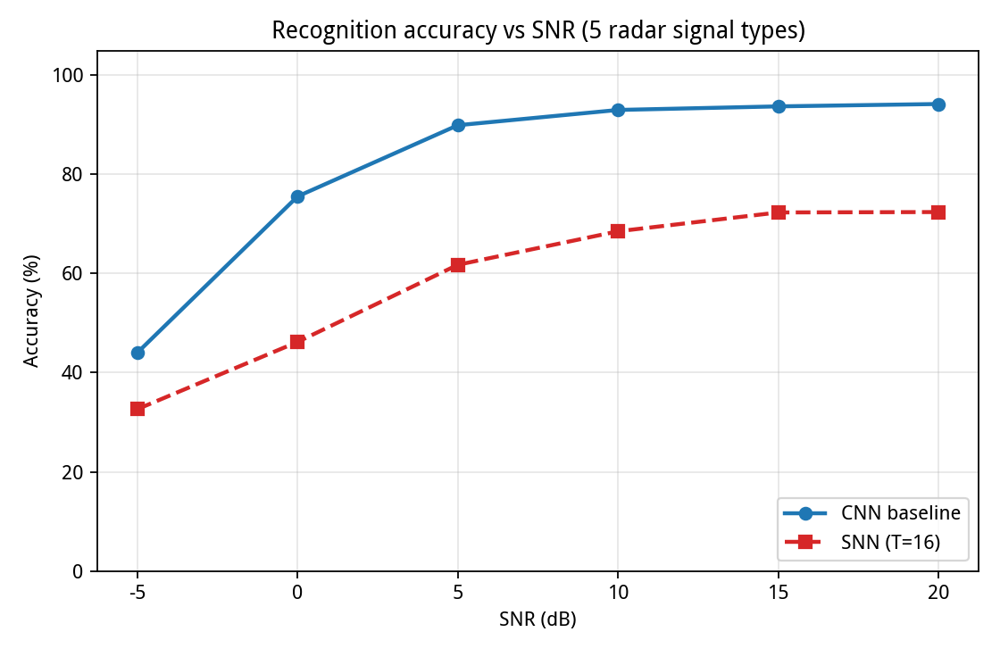
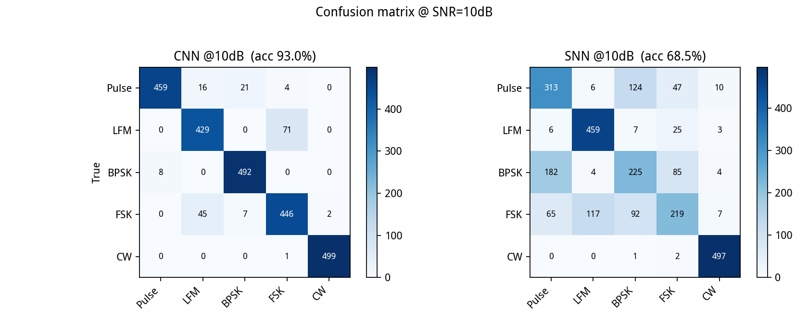

# 基于国产FPGA的SNN雷达信号智能识别系统

> **一句话定位**：面向电子侦察的低功耗雷达信号识别——算法已做通（CNN 基线做对照、类脑 **SNN** 为主方案），SNN 已 int8 量化并导出可部署权重 `.coe`，下一步请求老师指导在**国产 FPGA** 上实现 **事件驱动 LIF 推理引擎**，打通"训练→量化→上板"的国产化闭环。

---

## 一、背景与选题价值

战场/电子对抗中需对截获的雷达信号快速分类识别（LFM/BPSK/FSK/CW/常规脉冲），传统做法是 DSP 相关或 CNN 加速器；**SNN（脉冲神经网络）**用事件驱动稀疏计算，**无信号时几乎零功耗、有信号才计算**，天然契合军工"电池供电、长时间待机"场景。选题 = **雷达识别 + 类脑计算 + 国产化** 三交叉，与"人人都会的 CNN 加速器"区分。

## 二、已完成成果（软件侧，全部可复现）

**① 5 类雷达信号仿真库**（10MHz 采样，128 点/样本，参数随机：载频 1–3.5MHz、带宽 0.5–2MHz、脉宽/码率随机），加 AWGN（SNR −5~20dB），样本图见附录。

**② CNN 基线网络**（对照/保底，参数量约 1.7 万）与 **③ SNN 网络**（SpikingJelly 代理梯度直训，LIF×2 隐藏层，T=16），两者在同一测试集、同口径评估：

| SNR (dB) | −5 | 0 | 5 | 10 | 15 | 20 |
|---|---|---|---|---|---|---|
| CNN 基线 | 44.0% | 75.6% | 89.9% | **93.0%** | 93.7% | **94.2%** |
| SNN（T=16，第一版） | 32.6% | 46.2% | 61.8% | 68.5% | 72.3% | 72.4% |





**④ 已按 FPGA 友好定点完成 int8 量化并导出可部署权重**：power-of-2 定标（硬件右移即除法、免乘法器）、权重/偏置/阈值全部整数化，已生成 `.coe` 文件（fc1/fc2/fc3 共约 3.3 万字节，小容量 BRAM 即可放下）；int8 回验**识别率下降 ≤1pp**。

## 三、系统架构（软硬协同，硬件端是本次请求指导的重点）

```
软件端（已完成）                                 硬件端（待实现，★=特色）
信号仿真·CNN/SNN训练·int8量化导出                    ┌────────────────────────────┐
        │ UART 注入 128 点样本                      │ 脉冲编码前端(样本→T步脉冲)★   │
        ▼                                        │ LIF 神经元阵列(加法器+比较器)★│
  上位机(PC) ◀───── 识别结果 ────── 输出率累加+argmax │ 时间步调度器+活跃度门控★     │
                                                │ BRAM 权重/输入缓存·控制FSM   │
                                                └────────────────────────────┘
```

关键设计：极小网络（SNN 参数量约 3.4 万）+ int8 权重 + T=8~32 折中精度/延迟；**砍掉 ADC**（样本由上位机注入 BRAM），脉冲编码前端 + 活跃度门控 = 硬件"特殊性"与事件驱动省电的落点。

## 四、技术路线

- **已完成**：信号仿真、CNN 基线、SNN 训练、int8 量化与 `.coe` 导出、精度回验。
- **待做（请求指导部分）**：① 脉冲编码前端 ② LIF 神经元阵列 ③ 时间步调度/活跃度门控 ④ 整机 BRAM→UART 集成仿真与上板。SNN 结构极小且已量化，**回退到 CNN 方案作为保底路线已就绪**。

## 五、所需资源（恳请老师支持）

- **指导**：SNN 脉冲编码/LIF 硬件架构设计、FPGA 时序与上板调试经验。
- **开发板**：国产 FPGA 平台（紫光同创/高云/安路均可，中小规模 + 足够放 int8 权重的 BRAM 即可，老师有闲置板卡最佳），配套工具链与下载器。
- **时间**：报名 9/22 前，初赛 11/7 提交（报告+3 分钟视频+代码+照片），决赛 11 月底南京现场——希望本月内完成硬件仿真，上板目标在 10 月中旬。

## 六、下一步时间计划

| 时间 | 事项 |
|---|---|
| 9 月中旬 | 报名占坑 + 确认开发板；HDL/国产工具链上手 |
| 9–10 月 | 硬件各模块 RTL + testbench（先仿真后上板），SNN 精度随编码/结构迭代 |
| 11/7 | 初赛提交（报告 + 3 分钟演示视频） |
| 11/28–30 | 决赛现场（FPGA 编程考核 + 答辩） |

---

*附：5 类信号波形样例见 `../pre_test/figures/*_snr10dB.png`；全部代码/权重/说明整理于项目 `results/` 目录，可随时演示。*
